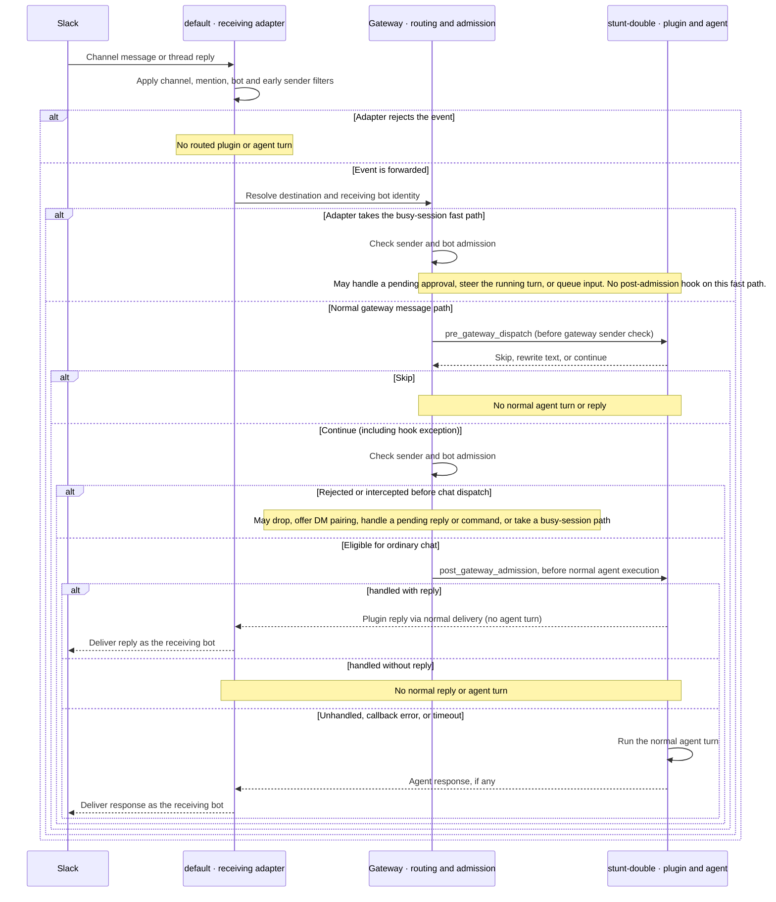

# Slack profile routing and dispatch

This swimlane diagram traces the built-in Slack adapter on unpatched Hermes (`0f602c5f6f`). The example is a shared bot: `default` owns the Slack connection, and a channel route selects `stunt-double` to handle the message. These lanes are responsibilities inside one gateway, not separate processes. Relay and webhook ingress are outside scope.

## Ordinary messages and busy sessions



- **Busy is not one path.** An input can be handled against the running session before the ordinary hook path, or queued for later. An input that continues into normal admission is evaluated there. A successful steer is not replayed as a second turn.
- **No normal reply is not no Slack activity.** On the native background path, typing and processing-start hooks can run before the gateway message handler. Consuming the message does not undo an indicator already sent.
- **Hook failures are different from an explicit skip.** `pre_gateway_dispatch` falls through on an exception; its direct async callback is not bounded by `plugins.hook_callback_timeout`. `post_gateway_admission` fails open when it does not produce a usable `handled` result, including after an error or timeout. Neither is a profile-wide no-fallback switch.

## Native slash commands

```mermaid
sequenceDiagram
    participant S as Slack
    participant A as default · receiving adapter
    participant G as Gateway · routing and dispatch
    participant P as stunt-double · plugin and agent

    S->>A: Native slash callback
    alt Channel blocked by slash channel gate
        A-->>S: Empty acknowledgement
        Note over A: Drop before dispatch
    else Channel passes slash channel gate
        A-->>S: Ephemeral Running acknowledgement
        A->>A: Check DM policy and early sender gate; normalize command text
        alt Event not forwarded
            Note over A: Already acknowledged, no agent turn
        else Event forwarded
            A->>G: Dispatch normalized event with route context
            alt Recognized command handled by gateway
                G-->>A: Command-specific outcome (may be silent)
                Note over G,P: Can finish before post_gateway_admission
                A-->>S: Deliver any command reply
            else Free-form /hermes question
                G->>P: Ordinary text path when eligible (see above)
                Note over A,P: A normal chat reply is not made ephemeral by the slash response URL
            end
        end
    end
```

The acknowledgement is separate from execution. The adapter can send **Running** before later checks drop the command, and a destination plugin cannot retract that acknowledgement by consuming the event. A typed slash-like message can reach gateway command handling too, but it does not begin at Slack’s native slash callback.

## Source references

- [Slack adapter: ordinary events and native slash callbacks](https://github.com/NousResearch/hermes-agent/blob/0f602c5f6f/plugins/platforms/slack/adapter.py#L6180-L6255)
- [Profile-scoped message and busy handlers](https://github.com/NousResearch/hermes-agent/blob/0f602c5f6f/gateway/run_adapters.py#L1570-L1632)
- [Inbound gateway dispatch](https://github.com/NousResearch/hermes-agent/blob/0f602c5f6f/gateway/run_inbound.py#L1353-L1442) and [busy handling](https://github.com/NousResearch/hermes-agent/blob/0f602c5f6f/gateway/run_busy.py#L941-L1005)
- [Hook contracts](../user-guide/features/hooks.md#pre_gateway_dispatch)
